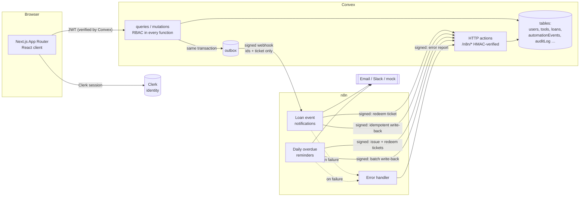
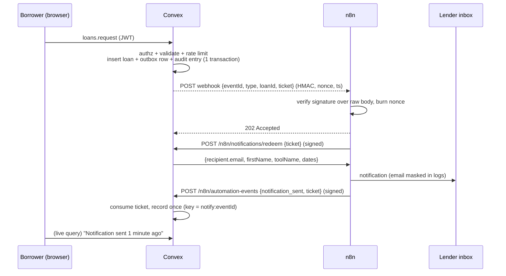

# LendLoop

**Borrow what you need. Lend what you don't.**

LendLoop is a tool-lending board for a neighbourhood. Neighbours list tools, ask to borrow them for a date range, and get notifications and overdue reminders sent by n8n.

**Stack:** Next.js 16 (App Router) · Clerk · Convex · n8n · TypeScript

I built it as if it would one day hold sensitive records rather than ladders and drills. The security design treats every boundary as hostile: browser ↔ Convex, Convex ↔ n8n, and n8n's own logs.

---

## Contents

1. [Security highlights](#1-security-highlights)
2. [Architecture](#2-architecture)
3. [Local setup](#3-local-setup)
4. [Environment variables](#4-environment-variables)
5. [Roles and access control](#5-roles-and-access-control)
6. [Security and data-minimization decisions](#6-security-and-data-minimization-decisions)
7. [n8n integration design](#7-n8n-integration-design)
8. [Testing](#8-testing)
9. [What I would change for production](#9-what-i-would-change-for-production)
10. [Trade-offs and known limits](#10-trade-offs-and-known-limits)

---

## 1. Security highlights

| | What | Why it matters |
|---|---|---|
| 🎟️ | **Contact details are released per message, never in bulk (claim check).** Both workflows work the same way. The loan-event webhook and the daily overdue list contain only opaque ids and single-use tickets that expire in 15 minutes. n8n trades each ticket in, over a signed call, for exactly the fields one message needs, and Convex writes every release to the audit log. | Email addresses never appear in webhook bodies, list responses, proxy or WAF logs. There is a per-recipient record of every time an address left the database. |
| 🧪 | **Access control is proved by tests, not just stated.** 26 tests run the real Convex functions in memory. They check every row of the role table in §5 for every kind of caller, and a guard test fails CI if a new public function appears without review. | "Enforced in Convex, not the UI" is checked on every push. |
| ✉️ | **Only verified email addresses are trusted.** An address is stored only if Clerk says it is verified. Notifications, reminders and admin bootstrap all depend on that. | Someone who signs up with another person's address receives nothing and can't be made admin. |
| ✍️ | **Signatures bound to timestamp, nonce, method and route, with key ids.** | Stops replays and cross-endpoint replays, and allows key rotation with no downtime. Each direction has its own key, so leaking one can't be used to forge the other. |
| 🔁 | **Retries sign each request again.** n8n retries go through a small loop that signs with a fresh nonce and timestamp each time. | A plain HTTP-node retry resends the old nonce, which a replay-protected endpoint correctly rejects. Most HMAC setups don't account for this. |
| 📬 | **Transactional outbox.** Events are written in the same Convex transaction as the change they describe, then delivered with exponential backoff and jitter. Failed events go to a dead-letter queue and can be retried from the admin panel. | An event can't be lost, and can't be sent for a change that rolled back. |
| 🧾 | **Idempotency keys built on the server.** Convex builds each write-back's key from facts it has checked, not from a value n8n supplies. | A buggy or compromised n8n can't create duplicate reminders by changing the key. |
| 🔗 | **Tamper-evident audit log.** Every entry stores the SHA-256 hash of the entry before it. Admins can check the whole chain with one click. | Editing, deleting or reordering past entries is detectable. Entries hold ids and actions only, no personal data. |
| 🚨 | **Failures show up in the app.** The n8n error workflow reports to Convex, so failures appear in the admin **Automation health** panel next to dead-lettered events. | Nothing fails silently, and operators don't need to log in to n8n to notice. |
| 🧹 | **Data minimization inside n8n.** Successful runs aren't saved; emails are masked in logs; an email exists only in a ticket-redemption response and the one node that sends the message; error reports are scrubbed. | n8n's execution history is a commonly overlooked store of personal data. |
| ✅ | **Tested against real n8n.** An end-to-end test runs the exported workflows on a real n8n instance against the actual Convex verification code. CI fails if a secret is committed or the workflow exports are out of date. | The claims above are checked by tests. |

---

## 2. Architecture



### What happens when someone asks to borrow a tool



### Repository layout

```
app/                     Next.js routes: public page + (app)/browse|listings|requests|incoming|admin
components/              UI pieces (forms, tables, badges)
convex/
  schema.ts              tables + indexes
  users.ts tools.ts loans.ts admin.ts      user-facing functions (all authorize first)
  outbox.ts              delivery, backoff, dead letters, ticket redemption
  automation.ts          nonce store, reminder tickets, idempotent write-backs, error sink
  http.ts                signed machine-to-machine endpoints for n8n
  crons.ts maintenance.ts   retention / cleanup
  lib/                   auth, signing, audit chain, sha256, rate limit, validation
n8n/
  src/lendloop-crypto.js signing helpers inlined into Code nodes (tested)
  workflows/*.json       exported workflows (generated, checked in)
scripts/                 workflow generator, secret generator, secret scanner
tests/                   unit tests + real-n8n end-to-end test
docker-compose.yml       n8n (+ optional import job and tunnel)
```

---

## 3. Local setup

**Prerequisites:** Node 22+ (24 if you run n8n through npm rather than Docker), Docker, a free Clerk account and a free Convex account.

### 3.1 App and Convex

```bash
npm install
cp .env.local.example .env.local
npx convex dev            # first run: log in and create the project; keep it running
```

### 3.2 Clerk

1. Create a Clerk application. Copy the **publishable key** and **secret key** into `.env.local`.
2. In the Clerk dashboard, open **Integrations → Convex** and activate it. This creates a JWT template named `convex`. Check that the token includes `email`, `email_verified` and `given_name`; LendLoop reads them from the verified token. **An address is stored only when `email_verified` is true.** If the claim is missing, sign-in still works but nobody receives notifications, and admin bootstrap can't find the account.
3. Tell Convex who issues the tokens:
   ```bash
   npx convex env set CLERK_JWT_ISSUER_DOMAIN https://<your-app>.clerk.accounts.dev
   ```

### 3.3 Generate the signing keys

```bash
npm run secrets:gen
```

This prints two `npx convex env set …` commands and a block for `.env.n8n`. Run the commands and paste the block. Nothing is written to disk for you.

### 3.4 n8n

```bash
cp .env.n8n.example .env.n8n     # paste the generated values; set LENDLOOP_CONVEX_SITE_URL
docker compose --profile setup run --rm n8n-import   # imports the 3 workflows
docker compose up -d n8n                              # editor at http://localhost:5678
```

In the n8n editor, open the three **LendLoop** workflows and **activate (publish)** them. Start with *Error handler*. The other two already point to it as their error workflow.

**Letting Convex reach n8n.** A Convex cloud deployment can't call `localhost`. Pick one option:

| Option | Steps |
|---|---|
| **A. Tunnel** (cloud Convex) | `docker compose --profile tunnel up tunnel`, then copy the `https://….trycloudflare.com` URL it prints. Set `N8N_PUBLIC_URL` in `.env.n8n` to it and restart n8n. Then run `npx convex env set N8N_LOAN_EVENTS_WEBHOOK_URL https://….trycloudflare.com/webhook/lendloop-loan-events` |
| **B. Local Convex backend** | Choose a *local* deployment when `npx convex dev` asks. Then run `npx convex env set N8N_LOAN_EVENTS_WEBHOOK_URL http://localhost:5678/webhook/lendloop-loan-events` and set `LENDLOOP_CONVEX_SITE_URL=http://host.docker.internal:3211` in `.env.n8n` |

### 3.5 Run

```bash
npm run dev       # http://localhost:3000  (keep `npx convex dev` running too)
```

Sign in once, then make yourself admin from the CLI. Only someone with deploy access can do this:

```bash
npx convex run admin:bootstrapAdmin '{"email":"you@example.com"}'
```

**Try it.** Use two browsers or accounts. One lists a tool; the other requests it. Watch `docker compose logs -f n8n` for the masked notification, then see "Notification sent" appear on the loan. To test reminders without waiting until 08:00 UTC, open *Daily overdue reminders* in n8n and click **Run now (manual)**.

---

## 4. Environment variables

No secret is in the code or the workflow JSON. Each value lives in exactly one place:

| Variable | Lives in | Purpose |
|---|---|---|
| `NEXT_PUBLIC_CONVEX_URL`, `CONVEX_DEPLOYMENT` | `.env.local` (written by `convex dev`) | Client → Convex |
| `NEXT_PUBLIC_CLERK_PUBLISHABLE_KEY`, `CLERK_SECRET_KEY` | `.env.local` | Clerk |
| `CLERK_JWT_ISSUER_DOMAIN` | Convex env | Convex verifies Clerk JWTs |
| `N8N_LOAN_EVENTS_WEBHOOK_URL` | Convex env | Where the outbox delivers |
| `CONVEX_TO_N8N_KEYS` | Convex env | **Signs** Convex → n8n. Format `kid:secret[,kid:secret]` |
| `N8N_TO_CONVEX_KEYS` | Convex env | **Verifies** n8n → Convex |
| `N8N_ENCRYPTION_KEY` | `.env.n8n` | Encrypts n8n's stored credentials |
| `LENDLOOP_CONVEX_SITE_URL` | `.env.n8n` | Convex HTTP actions base URL (`*.convex.site`) |
| `LENDLOOP_C2N_KEYS` | `.env.n8n` | **Verifies** Convex → n8n (same value as `CONVEX_TO_N8N_KEYS`) |
| `LENDLOOP_N2C_KEYS` | `.env.n8n` | **Signs** n8n → Convex (same value as `N8N_TO_CONVEX_KEYS`) |

`.env*` files are git-ignored except the `*.example` files, and `npm run secrets:check` fails CI if one is tracked. Secrets shorter than 32 characters are refused.

**Rotating a key without downtime:** add the new key in front on the *verifying* side (`new:…,old:…`), switch the *signing* side to the new key, then remove the old one.

---

## 5. Roles and access control

Authorization runs **inside every Convex function**. The UI only hides buttons as a convenience. Identity comes from the Clerk JWT that Convex verifies (`ctx.auth`). The role comes from LendLoop's own `users` table and never from anything the client sends. Owner ids are copied from the database record (`tool.ownerId`), never taken from function arguments.

| Action | Anonymous | User | Admin | Enforced in |
|---|:-:|:-:|:-:|---|
| See available tools (name and category only) | ✅ | ✅ | ✅ | `tools.publicList` |
| Browse with details and availability | | ✅ | ✅ | `tools.list` → `requireUser` |
| Create a listing | | ✅ (rate limited) | ✅ | `tools.create` |
| Edit or delete a listing | | own only | own only | `tools.update/remove` |
| Request to borrow | | ✅, not own tool | ✅ | `loans.request` |
| Approve, decline or mark returned | | own tools only | **own tools only** | `loans.decide/markReturned` |
| Cancel a request | | own requests | own requests | `loans.cancel` |
| Remove **any** listing (reason required, audited) | | | ✅ | `admin.removeListing` → `requireAdmin` |
| View all loans | | | ✅ | `admin.allLoans` |
| Mark a Trusted Lender | | | ✅ | `admin.setTrustedLender` |
| Promote an admin | | | | **CLI only** (`internalMutation`) |

Design choices:

- **Separation of duties.** Admins moderate content but can't approve or decline loans on someone else's tools. A moderator has no reason to lend out other people's property.
- **Same error for "doesn't exist" and "not yours".** Both return `NOT_FOUND`, so ids can't be probed.
- **No route to admin from the browser.** Admins are created by an internal function that only someone with deploy access can run.
- **Concurrency.** Convex mutations are serializable. Overlap checks, rate limits and audit-chain appends can't be bypassed by sending requests in parallel.

---

## 6. Security and data-minimization decisions

**Data minimization**

- The public page gets `{name, category}` only: no ids, owner, description or condition.
- Other members see a **first name and the trust badge**, never an email. Booked date ranges are shown without the borrower.
- Admins see emails masked (`j***@example.com`).
- Convex stores an email only because notifications need it. It's taken from the verified JWT and never returned to other users.
- n8n receives an email only through a ticket redemption, uses it in one node, and doesn't pass it on.
- Audit entries contain ids, actions and enum values only. The one free-text field is an admin's removal reason, which isn't personal data.
- Convex stores an email only if Clerk marks it **verified**. An unverified or removed address clears the stored one, and that change is audited as `verified` / `cleared`, never with the address itself. `bootstrapAdmin` looks users up by this verified address and refuses if more than one account matches.
- Every time a ticket is redeemed (the only way an email leaves Convex), an audit entry `ticket.redeemed` or `reminder_ticket.redeemed` is written with ids only. This gives a per-recipient record of every disclosure, which is the "who accessed what" record that health-data rules expect.
- **Retention:** nonces expire hourly; reminder tickets are dropped 2 days after they expire; delivered outbox rows and acknowledged errors are dropped after 30 days; old rate-limit windows after 2 days. n8n doesn't save successful runs and prunes failed ones after 7 days.

**Input and abuse**

- Every argument goes through a Convex validator. Text is trimmed, stripped of control characters and length-limited. Dates are strictly `YYYY-MM-DD`, no earlier than today, at most 30 days long and at most 90 days ahead.
- Rate limits are 10 borrow requests per hour and 20 listings per day per user, enforced in the same transaction as the write.
- Approving a request automatically declines other pending requests whose dates overlap, and those borrowers are notified.

**Machine-to-machine endpoints (`convex/http.ts`)**

- Request bodies are capped at 16 KB. The HMAC is checked first; the nonce is burned next; the JSON is parsed only after that.
- Every auth failure returns a generic `401`; the specific reason is only logged. Unknown, expired and used tickets all return the same `410`.
- No CORS headers are set, because browsers have no reason to call these endpoints.

**Web app**

- `proxy.ts` (Next 16's replacement for middleware) redirects signed-out users. It's only a convenience; bypassing it gains nothing, because Convex enforces access.
- Security headers are set: HSTS, `X-Frame-Options: DENY`, `nosniff`, Referrer-Policy and Permissions-Policy. The `X-Powered-By` header is turned off.

---

## 7. n8n integration design

Three workflows live in `n8n/workflows/`. They're **generated** by `scripts/build-n8n-workflows.mjs` from `n8n/src/lendloop-crypto.js`, so the signing code exists once and is unit-tested. They import into stock n8n. CI regenerates them and fails if the committed files differ.

| Workflow | Trigger | Flow |
|---|---|---|
| **Loan event notifications** | Webhook (`/webhook/lendloop-loan-events`) | Verify HMAC over the raw body → burn nonce → check payload shape → **respond 202** → redeem ticket (signed) → compose and send (mock) → record `notification_sent` (signed, idempotent) |
| **Daily overdue reminders** | Schedule, 08:00 UTC daily (plus **Run now**) | Signed POST `/n8n/reminders/tickets`: one ticket per overdue loan, ids only, and Convex already excludes loans reminded today → signed POST `/n8n/reminders/redeem` for the fields each reminder needs (audited per loan) → send each reminder (mock) → **one batched** signed write-back of `reminder_sent` / `reminder_failed`, each carrying its ticket → fail loudly if anything was rejected |
| **Error handler** | Error Trigger (set as the `errorWorkflow` of the other two) | Builds a short error report (no request data) → logs to n8n stdout → signed POST to Convex → shown in **Admin → Automation health** |

**Signature scheme**, the same in both directions:

```
HMAC-SHA256(secret,
  "LENDLOOP-HMAC-SHA256-V1\n" + keyId + "\n" + unixTs + "\n" + nonce + "\n" +
  METHOD + "\n" + route + "\n" + sha256hex(rawBody))
headers: x-lendloop-key-id, x-lendloop-timestamp, x-lendloop-nonce, x-lendloop-signature
```

Requests more than 5 minutes off are rejected. Each nonce is accepted once: Convex stores them in a table, and n8n keeps them in workflow static data. Comparisons are constant-time (`crypto.subtle.verify` in Convex, `timingSafeEqual` in n8n).

**Reliability**

| Failure | What happens |
|---|---|
| n8n is down when an event is created | Outbox retries with backoff of about 30s, 1m, 2m, 4m and 8m, plus jitter. After 6 failures the event is dead-lettered and an admin can retry it. |
| Convex returns 5xx or times out | n8n's retry loop signs again, then waits 2, 4 and 8 seconds. After 4 attempts the run fails and the error workflow fires. |
| Convex rejects with 400, 401, 403, 413 or 422 | Fails immediately with no retry, because retrying wouldn't help. |
| The same write-back arrives twice | Convex returns `duplicate` for anything already recorded, using keys `notify:<eventId>` and `<kind>:<loanId>:<date>`. |
| A ticket was already used or replaced | Redeem returns `410` and the workflow stops quietly, since the notification was already handled. A used, expired or no-longer-overdue reminder ticket is left out of the redeem response, so nothing is sent. |
| The reminder run fails part-way | Run it again the same day. Loans already recorded as `reminder_sent` are skipped, and the others get fresh tickets. |
| The error reporter can't reach Convex | The failure is still logged to n8n stdout, so it's never silent. |

**Switching to a real notification channel.** Replace the marked "mock channel" block in *Compose + deliver* and *Send reminders* with a Send Email, Slack or Discord node. That node must use an **n8n credential**, never a token pasted into a field. The workflow JSON then refers to the credential by id only, and `npm run secrets:check` blocks inline credential data.

**Environment access in n8n.** The Code nodes read `LENDLOOP_*` through `$env`, which requires `N8N_BLOCK_ENV_ACCESS_IN_NODE=false` and `NODE_FUNCTION_ALLOW_BUILTIN=crypto`. This keeps secrets out of the exported JSON, as the brief requires. The trade-off: anyone who can *edit* workflows can read those variables. That's acceptable for a single-operator local setup; see §9 for production.

---

## 8. Testing

```bash
npm run typecheck && npx tsc -p convex --noEmit   # app + Convex functions
npm test                # 13 unit tests + 26 Convex function tests
npm run secrets:check   # repo + workflow exports
N8N_BIN=$(npm root -g)/n8n/bin/n8n npm run test:e2e   # against a real n8n
```

**Convex function tests (`tests/convex/`)** run the real queries, mutations and HTTP routes against [`convex-test`](https://docs.convex.dev/testing/convex-test)'s in-memory backend in the edge runtime. They use a fixed cast: Alice lends, Bob borrows, Eve is an unrelated user, Ada is an admin.

- **`rbac.test.ts`** checks every row of the table in §5:
  - Anonymous callers get `UNAUTHENTICATED`.
  - Users get `NOT_FOUND` on other people's listings and loans.
  - The borrower, an unrelated user *and an admin* can't approve, decline or mark returned on someone else's tool (separation of duties).
  - Non-admins get `FORBIDDEN` on every admin function.
  - A role claim in the token is ignored.
  - Responses carry no emails or owner ids.
  - An **API-surface guard** lists every browser-callable function. Adding a public function fails CI until someone reviews it and adds it to the list.
- **`automation.test.ts`** calls the signed HTTP routes the way n8n does:
  - The overdue ticket list contains no personal data.
  - A redemption releases only what a reminder needs and is audited.
  - Write-backs need the ticket for that loan, record once, and fail after the ticket expires.
  - A loan returned after its tickets were issued discloses nothing.
  - Unsigned, tampered, cross-route and replayed requests get `401`.
  - Unverified emails are never stored or used, and admin bootstrap can't be pointed at one.

To confirm these tests check something real, I removed the owner check from `loans.decide`; the suite failed, and passed again once I restored it.

**Unit tests (`tests/signing.test.ts`)** check:

- The Convex and n8n signing code accept each other's signatures in both directions.
- Tampered bodies, cross-route and cross-method replays, stale timestamps, unknown keys and short secrets are rejected.
- Key rotation works.
- The pure-TypeScript SHA-256 matches `node:crypto`.
- The audit chain detects an edited entry and a deleted entry.
- Date-overlap edge cases.

**End-to-end test (`tests/e2e/n8n.e2e.ts`).** It imports and publishes the **actual exported workflows** into a throwaway n8n instance. A mock Convex HTTP layer uses the real `verifyRequest` code. The test checks:

1. A valid signed event gets `202`, the ticket is redeemed, `notification_sent` is recorded, and n8n logs show only the masked email.
2. A tampered body gets `401`, and an exact replay also gets `401`. Neither reaches Convex.
3. The reminder run issues and redeems tickets, writes back, and running it again doesn't create a duplicate; the borrower's email appears in n8n logs only masked.
4. When Convex keeps failing: 4 attempts are made, each with a **fresh, valid signature**; the error workflow then reports to Convex, and the report contains no signatures or tickets.

I ran it against n8n 2.49.5. All checks pass.

**CI (`.github/workflows/ci.yml`)** runs both typechecks, the unit and Convex function tests, checks that the workflow exports are current, runs the secret scan, and runs `npm audit --omit=dev`.

---

## 9. What I would change for production

**Identity and access**

- Pass roles through a Clerk organization or role claim, with a single Convex function that re-checks them, if more roles are needed. Require MFA for admins, and step-up re-verification for destructive admin actions.
- Add an admin "break-glass" procedure and alerts whenever someone is promoted to admin.

**Secrets and n8n**

- Turn `$env` access back off. Read keys from n8n **external secrets** (Vault, AWS Secrets Manager) or n8n credentials, or move signing into a small sidecar so workflow editors never see key material.
- Rotate keys on a schedule with the key-id scheme (two active keys during the switch).
- Run n8n in queue mode with Postgres and Redis, external task runners, SSO for the editor, an exact image pinned by digest, and the editor reachable only through a VPN or private network. Use a stable public URL for webhooks instead of a tunnel, with TLS and a WAF rate limit in front.
- Move the nonce store to Redis with a TTL so it's shared across n8n workers.

**Data and compliance**

- Write a data inventory and a retention policy per table. Add export and delete flows for each user's data. Clean up personal data when a user is deleted, using a Clerk `user.deleted` webhook that is verified with Svix signatures.
- Anchor the audit chain externally, for example by posting the head hash to S3 Object Lock or a separate account each day, so even someone with database access can't rewrite the whole chain.
- Use field-level encryption for email, with a KMS key per environment.

**Operational visibility**

- Send structured logs to Datadog, and use Sentry for the Next.js app and Convex functions.
- Alert on: dead letters above 0, oldest pending outbox event older than 15 minutes, error-workflow events, a spike in 401s on `/n8n/*` (a possible attack or clock drift), and audit-chain verification failures.
- Trace the outbox → n8n → write-back flow end to end using the event id as a correlation id.

**Web hardening**

- Add a strict Content-Security-Policy built from the exact Clerk and Convex origins, using a nonce. Turn on Clerk bot protection for sign-up.
- Add abuse reporting on listings, and a moderation queue instead of instant removal.

**Product**

- Use local timezones instead of UTC for due dates and reminder times.
- Let users choose notification preferences and opt out.
- Add pagination to lists that are currently capped (for example `take(200)`).

---

## 10. Trade-offs and known limits

- **n8n responds 202 before it sends the notification.** This keeps the Convex outbox simple: delivered to n8n means handed off. Failures after that point go through n8n's retry loop and error workflow instead.
- **Delivery is at least once.** If a notification is sent but the write-back fails all its retries, a manual re-run can send it a second time. The write-back itself is still recorded only once.
- **Each delivery attempt creates a new ticket.** A slow first attempt and a retry can overlap; the older ticket then gets `410` and stops quietly.
- **The notification channel is a mock**, as the brief allows: a logged message with the email masked. Switching to a real channel is a one-node change (§7).
- **The workflow generator** is a small dependency-free script rather than a framework. The exported JSON is still normal n8n JSON you can edit in the UI; just regenerate it, or update `scripts/` afterwards.
- **At most 100 reminders per run.** That matches the write-back batch limit, so a run never builds a batch Convex would reject. Any loans beyond 100 get their reminder on the next run, or after a **Run now**. Paging through them would remove the limit.
